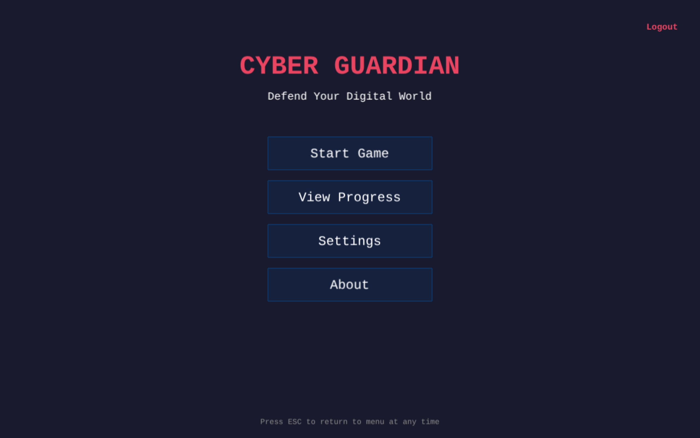
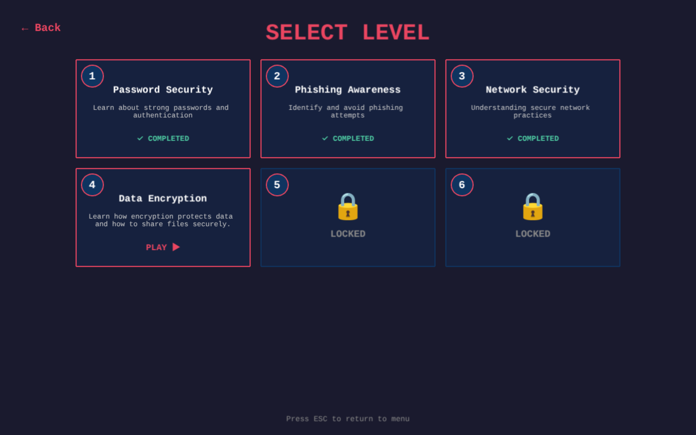
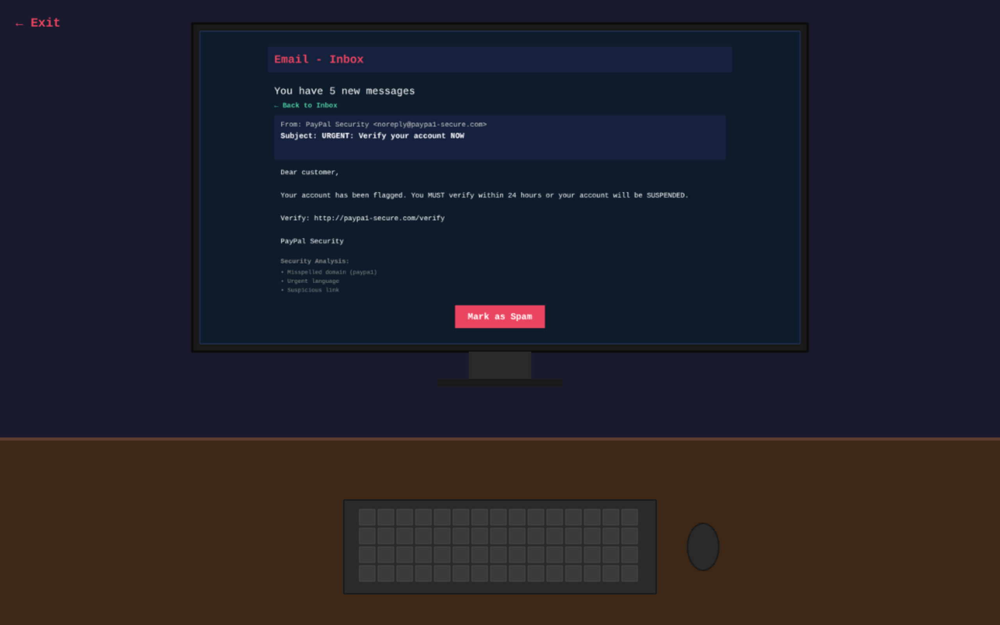
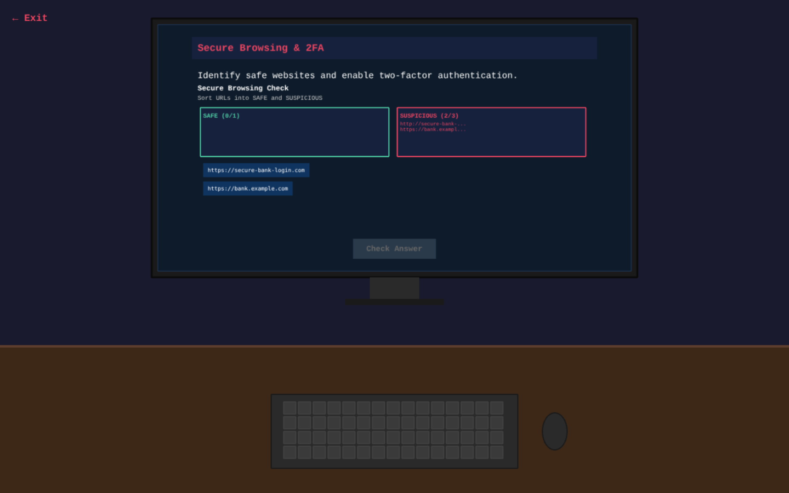
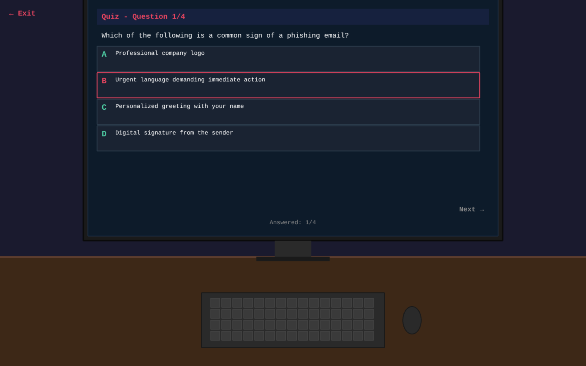
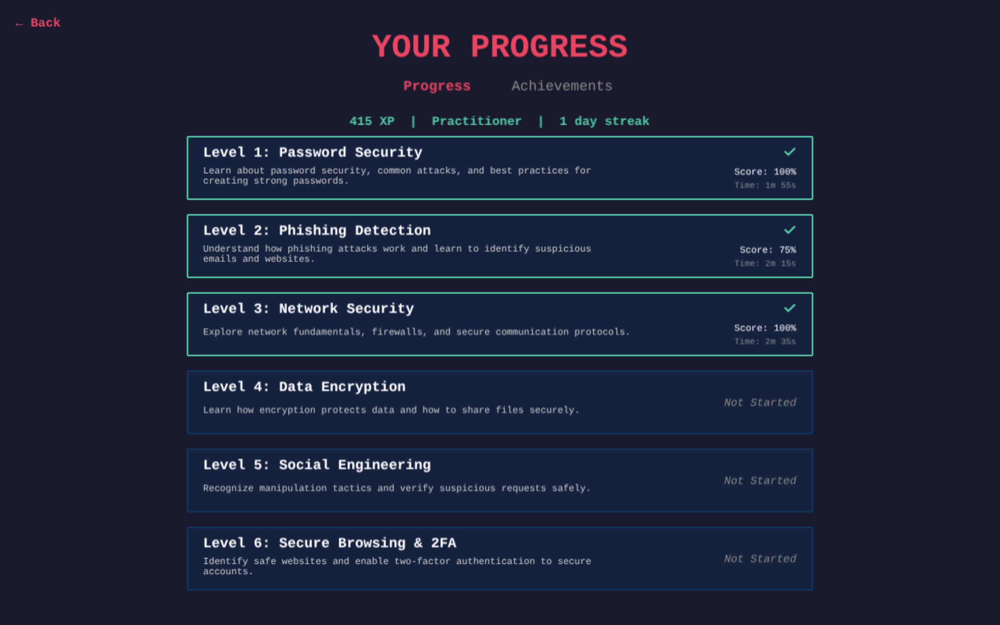
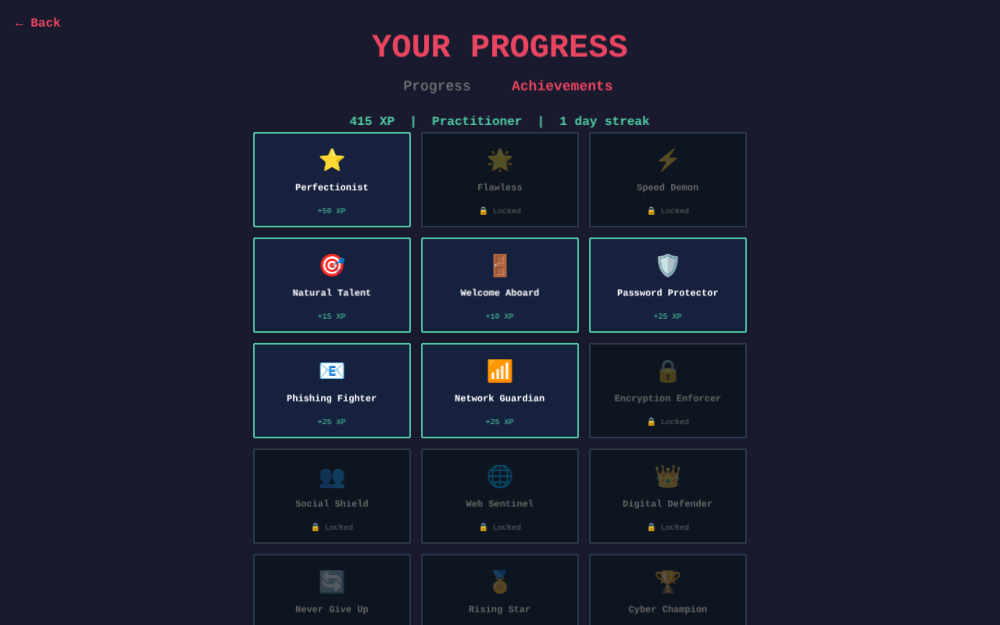

# Cyber Guardian

A browser game for learning basic cyber security. You play through six levels on a simulated computer, and each level ends with a short quiz.

Final year project for BSc Computer Science (Information Security) at Royal Holloway, University of London, 2026.

[Gameplay video](https://youtu.be/QHnK4I4bPko)

## Levels

1. Password Security: create a password and get a strength rating
2. Phishing Detection: find the phishing emails in an inbox
3. Network Security: choose the safe Wi-Fi network
4. Data Encryption: put together a secure file transfer
5. Social Engineering: handle a fake IT support call
6. Secure Browsing and 2FA: spot fake URLs and sort 2FA methods

Each quiz has four questions, is marked by the server and needs 70% to pass. The game also has accounts, saved progress, XP, security ratings and 25 achievements.

## Screenshots

| | |
|---|---|
|  |  |
|  |  |
|  |  |



## Tech

- Frontend: Phaser 3, TypeScript, Vite, Tailwind CSS, Zod
- Backend: Python, FastAPI, Pydantic, asyncpg
- Database: PostgreSQL
- Auth: bcrypt password hashing, JWT

## Running it

Needs Python 3.11+, [uv](https://docs.astral.sh/uv/), PostgreSQL and Node.js 18+.

Database:

```bash
createdb cybersec_game
psql cybersec_game < backend/schema.sql
```

Backend (http://localhost:8000):

```bash
cd backend
uv sync
cp .env.example .env    # set DATABASE_URL and SECRET_KEY
uv run uvicorn app.main:app --reload --port 8000
```

Frontend (http://localhost:5173):

```bash
cd frontend
npm install
npm run dev
```

## Tests

```bash
cd backend
uv sync --extra dev
uv run pytest
```
